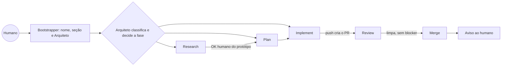

# Fábrica Agêntica V2

A Fábrica Agêntica V2 é a versão nova e atualizada da Fábrica Agêntica (V1): uma fábrica de desenvolvimento de software feita de bots do Grok Bot e agentes de nuvem do Cursor. Recebe um pedido do humano e entrega código mergeado, passando por research, plan, implement e review, com o humano só onde a decisão é dele.

A V2 foi otimizada para reduzir o consumo de tokens. A auditoria de consumo mostrou que a quantidade de bots era o grande vilão: o autoconsumo dos bots e o cache relido a cada mensagem. Por isso a V2 reduziu o número de bots. Os motivos são conhecidos, mas essa redução ainda não foi comprovada em teste real.

**Dono:** Elienaldo Bittencourt · **Última atualização deste README:** 2026-11-17

## Sumário
1. [Bots](#1-bots)
2. [Fluxo de uma feature](#2-fluxo-de-uma-feature)
3. [Comunicação](#3-comunicação)
4. [Criação de seção](#4-criação-de-seção)
5. [Destruição da feature](#5-destruição-da-feature)
6. [Avisos por webhook](#6-avisos-por-webhook)
7. [Padrões](#7-padrões)
8. [Estrutura de pastas](#8-estrutura-de-pastas)
9. [Onde vive cada coisa](#9-onde-vive-cada-coisa)

## 1. Bots

| Bot | Tipo | Função |
| --- | --- | --- |
| **Bootstrapper** | Permanente (porta de entrada) | Recebe o pedido do humano, cria o nome da feature (`feat-...` ou `fix-...`), roda o script de criação de seção, confere a seção, cria o Arquiteto dentro dela e sai de cena. Também recebe os avisos dos scripts e repassa ao humano. Não classifica, não fala com o Cursor e não executa destruição. Ficha: `markdown/modelos/bootstrapper.md`. Skills: `bootstrapper-start` e `bootstrapper-criacao-arquiteto`. |
| **Arquiteto** | Um por feature, dentro da seção da feature | Conduz a feature de ponta a ponta: classifica, decide a fase, conduz research, plan, implement e review, opera o Cursor, faz o merge e, só com autorização humana explícita, dispara a destruição. É o único bot da feature. Ficha: `markdown/modelos/arquiteto.md`. Skills: `arquiteto-regras` (camada 1) e 7 de camada 2. Criado dinamicamente pelo Bootstrapper, um por feature, logo depois da seção; nunca é criado à mão no app. |
| **Âncora V2** | Permanente, de apoio | Não participa da feature. O script de criação usa o Âncora V2 para abrir a seção nova e depois o devolve à seção Fábrica Agêntica V2. |

**Bootstrapper com dois papéis, por design:** (1) dar a partida de cada feature — criar o nome, a seção e o Arquiteto — e sair de cena; (2) repassar ao humano os avisos de bloqueio dos webhooks. O aviso de bloqueio da destruição pode chegar quando o Arquiteto da feature já não existe, então a devolução ao humano fica com o Bootstrapper.

**Cursor:** agentes de nuvem que escrevem o código numa VM própria, em branch própria. Só o Arquiteto abre sessão no Cursor.

## 2. Fluxo de uma feature



- **Classificação:** o Arquiteto classifica a demanda em criticidade, risco e complexidade (cada uma baixa, média ou alta) e responde SIM ou NÃO a estas 5 perguntas:
  1. **Muda arquitetura?** Pergunta se a demanda altera a arquitetura.
  2. **Afeta mais de um serviço, ou um componente de que muitos dependem?** Pergunta se o alcance vai além de um único serviço, ou se atinge um componente do qual muitos outros dependem.
  3. **Tem ambiguidade de requisito?** Pergunta se o requisito está ambíguo — se não está claro o que deve ser feito.
  4. **É difícil de desfazer?** Pergunta se a mudança é difícil de reverter: se mexe em dados persistidos, faz migração ou quebra contrato de API.
  5. **Toca autenticação, permissões, dados pessoais ou segredos?** Pergunta se a demanda entra em autenticação, permissões, dados pessoais ou segredos.

  Se a demanda trouxer a classificação indicada pelo humano (ex.: "utilize como alta"), essa tag tem prioridade e o Arquiteto a usa, sem passar pelas perguntas. Com as respostas e a avaliação, o Arquiteto decide a fase: research, plan ou implement. Não há roteamento fixo: o Arquiteto pode ir direto ao plan ou ao implement.
- **Research:** o Arquiteto acumula engenharia de produto, protótipo e matriz de objeções. O OK humano do protótipo é obrigatório antes do plan.
- **Plan e implement:** sessão nova do Cursor com a skill `tlc-spec-lean`.
- **Review:** obrigatória antes do merge, com a `the-judge`. No máximo 3 rodadas.
- **Depois do merge:** ambiente dev, link ao humano e produção só com confirmação explícita.
- Detalhe de cada fase: `markdown/fases/fase-research.md`, `fase-plan.md`, `fase-implement.md` e `fase-review.md`.

## 3. Comunicação

- Um grupo por fase: `<fase>-<feature>` (research, plan, implement, review), criado pelo Arquiteto. Membros: só o Arquiteto e o humano.
- O Cursor não entra em grupo. O retorno chega ao Arquiteto pela notificação de conclusão do agente de nuvem.
- O Bootstrapper só fala com o humano no pedido e nos avisos dos scripts.

## 4. Criação de seção

- Quem roda: o Bootstrapper.
- Comando: `py -3 scripts\criar-secao-feature.py "<nome-da-feature>"`.
- O script (`criar-secao-feature.py` + `criar-secao-feature.ps1`) usa o Âncora V2 para criar a seção, devolve o Âncora V2 à seção Fábrica Agêntica V2 e confere que a seção ficou vazia. Não cria bots.
- Só depois de sucesso confirmado o Bootstrapper cria, dentro da seção, o Arquiteto exclusivo daquela feature, a partir da ficha `markdown/modelos/arquiteto.md`. O Arquiteto não é criado à mão no app: cada feature nova ganha o seu.
- Contrato: `contratos/contrato-webhook-criacao.md`.

## 5. Destruição da feature

- Quem roda: o Arquiteto, só com autorização humana explícita de alvo e alcance. Merge ou fim da feature, sozinhos, não autorizam.
- Script: `scripts/destruir-secao-api.py`, com `grokbot_api_client.py` e `destruir-secao-config.json` (rota única: API interna; bot, seção e grupos validados no bloco `api_interna`).
- Ordem, em uma passagem: Arquiteto (etapa 4), seção (etapa 5) e grupos `<fase>-<feature>` (etapa 6, só com `--confirmar-grupos`).
- Bots protegidos: o cliente da API (`FIXOS_POR_ID` em `scripts/grokbot_api_client.py`) recusa excluir três: Âncora V2 (`3aa31f55…`), Mestre de obras (`c48d6f40…`) e Bootstrapper (`f99cfa31…`); o script de destruição, no plano, bloqueia o Bootstrapper. Seções protegidas: Fábrica Agêntica V2, Fábrica Agêntica e Uso Pessoal.
- Sem `--executar` o script só planeja (dry-run).
- Contratos: `contratos/contrato-destruicao-api-interna.md` e `contratos/contrato-webhook-destruicao.md`. Desenho: `excalidraw/destruicao-api-interna.excalidraw`.

## 6. Avisos por webhook

| | Criação | Destruição |
| --- | --- | --- |
| Quando envia | Sempre ao terminar (sucesso ou falha) | Só no bloqueio inicial (exit 2, `stage=preflight`) |
| Notificador | `scripts/notificacao_criacao_v2.py` | `scripts/notificacao_bootstrapper.py` |
| Rotina do Bootstrapper | "Fábrica V2 — bloqueio criação" | "Fábrica V2 — bloqueio destruição" |
| Variáveis | `FABRICA_V2_CRIACAO_WEBHOOK_URL` / `_KEY` | `FABRICA_V2_WEBHOOK_URL` / `_KEY` |

- As rotinas só registram e avisam o humano. Não criam, não executam, não corrigem e não acionam outro bot.
- Os scripts leem as variáveis de ambiente da tabela acima. Só enxergam as variáveis em terminais abertos depois da gravação.
- Uma tentativa, sem retry. HTTP 200 não prova que o humano leu.
- Nos demais erros da destruição nada é enviado: o resultado traz `needs_human_notification` e o Arquiteto repassa.
- Testes puros (sem rede): `scripts/test_notificacao_criacao_v2.py`, `scripts/test_notificacao_bootstrapper.py` e `scripts/test_destruir_secao_api.py`.

## 7. Padrões

- **Branch por pedido:** `feat/YYYYMMDD-nome-da-task` ou `fix/YYYYMMDD-nome-da-task`. Nunca a `main`.
- **Modelo padrão do Cursor:** grok-4.7, reasoning_effort high, fast false, context 500k, quando o pedido não indicar outro.
- **Regra 28:** cada fase em conversa nova; o handoff leva só a decisão e o link do artefato.
- **Sem agente real em teste sem o ok do humano;** nunca expor chaves; nunca relançar em laço após erro.
- **Regra de ouro:** backup antes de alterar, hash antes e depois, reler o que foi salvo. Skills mudam no box, no espelho `skills/` e na descrição do bot ao mesmo tempo.
- **Log de tokens:** uma linha por chamada ao modelo em `logs/consumo-tokens.jsonl`, sem inventar valores.

## 8. Estrutura de pastas

```
Fabrica-Agentica-V2/
├── README.md
├── checklist-v2.html          # Kanban da V2 (estado no navegador)
├── skills/                    # espelho das skills do box: arquiteto-* (8) e bootstrapper-* (2)
├── contratos/
│   ├── contrato-webhook-criacao.md
│   ├── contrato-webhook-destruicao.md
│   ├── contrato-destruicao-api-interna.md
│   └── execucao-verificacao/fluxo-contrato-verificacao.md
├── scripts/                   # criação, destruição, notificadores e testes
├── excalidraw/                # diagramas (fonte); índice em LINKS.md
├── markdown/
│   ├── fases/                 # documento de cada fase (camada 3 do Arquiteto)
│   ├── modelos/               # fichas arquiteto.md e bootstrapper.md; visão geral fábrica-agêntica-v2.md
│   ├── regras/                # convencoes-fabrica.md
│   ├── automacoes/            # comunicacao-bidirecional-cursor.md
│   ├── decisoes/              # registro das decisões, por data
│   └── comunicacao.md
└── logs/                      # consumo-tokens.jsonl
```

## 9. Onde vive cada coisa

| O quê | Onde |
| --- | --- |
| Skills (fonte) | box: `/home/box/agent-data/workflows/arquiteto-*` e `bootstrapper-*`. Espelho no PC: `skills/`. |
| Fichas dos bots | `markdown/modelos/arquiteto.md` e `markdown/modelos/bootstrapper.md` |
| Visão geral e regras comuns | `markdown/modelos/fábrica-agêntica-v2.md` |
| Scripts, config e testes | `scripts/` |
| Diagramas | `excalidraw/`, índice em `excalidraw/LINKS.md` |
| Kanban | `checklist-v2.html` |
| Log de tokens | `logs/consumo-tokens.jsonl` |
| Backups | `C:\Users\Elienaldo\Projetos\Fabrica-Agentica-backups\` (fora do Git) |
