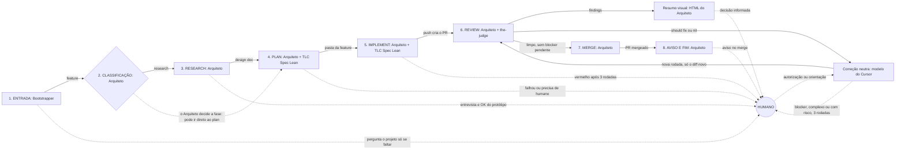

# Contrato de execução e verificação (V2)

Registro em texto do diagrama `excalidraw/contrato/fluxo-contrato-verificacao.excalidraw` (fonte: o arquivo no disco). Cada seta leva o artefato que passa de uma fase para a próxima. Escaladas vão sempre pelo Arquiteto, no grupo da fase ativa (`<fase>-<feature>`).

Limites de rodadas, contados separadamente: implement 3; the-judge 3 por execução; correção dos findings 3. Merge: última rodada da the-judge limpa e sem blocker pendente (nit pode ficar).

Toda fase nova (research, plan, implement e review) começa com o Arquiteto abrindo uma sessão nova no Cursor, com contexto limpo. O Arquiteto fala com o humano no grupo da fase ativa, leva as escaladas e registra as decisões.

| Fase | Quem faz | Ação | Artefato que sai |
| --- | --- | --- | --- |
| 1. Entrada | Bootstrapper | Recebe o pedido, cria o nome `feat-`/`fix-`, dispara o script de criação, verifica a seção, cria o Arquiteto e sai de cena. | feature |
| 2. Classificação | Arquiteto | 5 perguntas SIM/NÃO; a tag do humano tem prioridade; decide a fase (sem roteamento fixo). | fase |
| 3. Research | Arquiteto | Engenharia de produto, protótipo e matriz de objeções; sessão nova no Cursor; OK humano do protótipo antes do plan. | design doc |
| 4. Plan | Arquiteto + Cursor com TLC Spec Lean | Gera plan.md, checks.md e os demais arquivos da pasta. | pasta da feature |
| 5. Implement | Arquiteto + Cursor com TLC Spec Lean | Build, testes e verificação internos da skill (Verifier e commits internos); push cria o PR; 3 rodadas sem verde: avisa o humano. | PR |
| 6. Review | Arquiteto + the-judge | Obrigatória antes do merge. A the-judge classifica em blocker, should fix e nit (máx. 3 rodadas por execução). O Arquiteto gera o resumo visual (HTML). O modelo do Cursor corrige should fix e nit (máx. 3 rodadas); blocker só com autorização do humano. | findings, HTML |
| 7. Merge | Arquiteto | Dispara o merge no GitHub com a review limpa. | PR mergeado |
| 8. Aviso e fim | Arquiteto | Avisa o humano no merge. Com autorização humana explícita de encerramento, só avisa o Bootstrapper (handoff); o Bootstrapper valida as travas (pergunta ao humano só com divergência) e roda `scripts/destruir-secao-api.py`. | aviso |