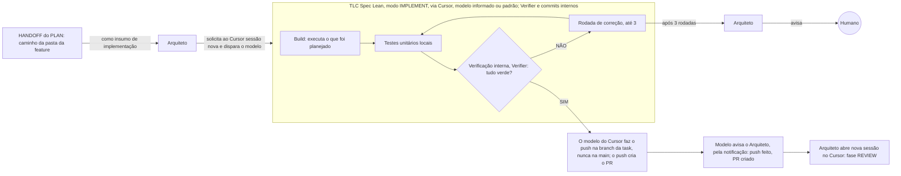

# Fábrica agêntica - Fase IMPLEMENT

Registro em texto da fase IMPLEMENT na V2. Entra depois do handoff da fase PLAN, ou com o insumo direto quando a avaliação inicial do Arquiteto leva a demanda direto ao implement. O Arquiteto é o único bot da feature.

## Peças

| Peça | O que faz |
| --- | --- |
| HANDOFF do PLAN | Entrega o caminho da pasta da feature (com `plan.md` e `checks.md`). |
| Arquiteto | Solicita ao Cursor a sessão nova da fase e o disparo da skill pelo modelo (só o Arquiteto dispara o Cursor). Orienta o modelo a fazer o push ao final se a verificação passar. Não escreve código. |
| TLC Spec Lean (modo implement) | Disparada via Cursor, com o modelo informado ou o padrão. Recebe o caminho da pasta da feature e executa o que foi planejado. |
| Build | A skill executa o que foi planejado. |
| Testes unitários | Rodam localmente, a partir dos checks do plan. |
| Verificação | Subtarefa interna da skill (Verifier, parte da TLC Spec Lean, não é fase nem agente): confere se tudo está verde e gera o `verification.md`. Os commits também são internos da skill. |
| Rodada de correção | Até 3 rodadas, voltando a testar. |
| Escalar | Depois de 3 rodadas sem ficar verde, o Arquiteto avisa o humano. |
| Regra | Teste vermelho é parada. Não se enfraquece a asserção. |
| Handoff final | Com a verificação ok, o modelo do Cursor faz o push na branch da task (nunca na main) e o push cria o PR. O modelo avisa o Arquiteto pela notificação, e o Arquiteto abre uma nova sessão para a fase REVIEW. Se a verificação falhar, não há push. Detalhe na seção 12 de `arquiteto-review-merge`. |

## Nota

A skill real é `tlc-spec-lean`. A escalada vai ao humano pelo Arquiteto.

Toda fase nova (research, plan, implement e review) começa com o Arquiteto solicitando ao Cursor que abra uma nova sessão, com contexto limpo, sem exceção. A implement começa com o Arquiteto abrindo a sessão nova, e a review também. O handoff entre fases passa sempre pelo Arquiteto, que dispara a sessão nova.

Quando a fase IMPLEMENT abrir grupo (regra 28), ele se chama `implement-<nome-da-feature>` (exemplo: `implement-feat-nome-da-feature`), com o nome da feature igual ao da seção criada (prefixo `feat` ou `fix`, hífen e o nome em minúsculas com hífens). Regra em `../comunicacao.md`, seção 5.
