# Fábrica agêntica - Fase PLAN

Registro em texto da fase PLAN na V2. O Arquiteto é o único bot da feature: recebe os insumos, abre a sessão nova no Cursor e confere o resultado. Esta fase fica entre o pedido de feature (ou a fase RESEARCH) e a fase IMPLEMENTAÇÃO.

```mermaid
flowchart LR
  A["Pedido de feature"] --> B["Arquiteto"]
  B --> D{"5 perguntas e avaliação: o Arquiteto decide a fase"}
  D -- "research" --> R["Fase RESEARCH: entrega o design doc ou PRD"]
  R -- "design doc ou PRD, e o protótipo validado pelo humano, quando houver" --> AR["Arquiteto: recebe os insumos e decide se é plan"]
  D -- "plan, sem research: solicitação direta" --> AR
  AR -- "1. solicita ao Cursor a abertura da sessão nova da fase plan" --> CS["Cursor: sessão nova, contexto limpo, no início da fase plan"]
  CS -- "2. na sessão nova, dispara a skill" --> M["Modelo do Cursor: TLC Spec Lean, modo PLAN, modelo informado ou padrão"]
  M -- "a skill gera os 5 arquivos" --> H["Pasta da feature: plan.md, checks.md, verification.md, STATE.md e LESSONS.md"]
  M -- "3. notificação de conclusão" --> AR2["Arquiteto: confere o resultado"]
  AR2 --> C{"falhou ou precisa de humano?"}
  C -- "SIM" --> HU(("Humano"))
  C -- "NÃO: pasta como insumo de implementação" --> I["Fase IMPLEMENTAÇÃO: checks viram os testes unitários"]
```

## Peças

| Peça | O que faz |
| --- | --- |
| Pedido de feature | Entrada da fase. |
| Arquiteto | Responde às 5 perguntas de classificação, recebe os insumos (design doc, PRD ou solicitação direta) e decide a fase. Solicita ao Cursor a abertura da sessão nova da fase plan, com contexto limpo. Recebe a notificação de conclusão e confere o resultado. Faz a comunicação com o humano. |
| 5 perguntas | 1. Muda arquitetura? 2. Afeta mais de um serviço, ou um componente de que muitos dependem? 3. Tem ambiguidade de requisito? 4. É difícil de desfazer? Mexe em dados persistidos, faz migração ou quebra contrato de API? 5. Toca autenticação, permissões, dados pessoais ou segredos? Com as respostas e a avaliação, o Arquiteto decide a fase: research, plan ou implement. Não há roteamento fixo. |
| Fase RESEARCH | Entrega o design doc ou PRD que alimenta o plan, e o protótipo, quando houver, depois do OK explícito do humano. |
| TLC Spec Lean (modo plan) | O Arquiteto abre a sessão nova, com contexto limpo, e nela o modelo (informado ou padrão) dispara a skill, com projeto, feature e modelo. Recebe o design doc ou PRD do research, ou a solicitação direta. Se houver protótipo, registra a referência a ele no `plan.md`. Gera `plan.md`, `checks.md`, `verification.md` (reservado, gerado pela própria skill depois do build, pelo Verifier interno), `STATE.md` e `LESSONS.md` dentro da pasta da feature. Não cria tasks. |
| Handoff | Ao concluir, o modelo notifica o Arquiteto, que confere o resultado. Se falhou ou precisa de humano, o Arquiteto avisa o humano. Se deu certo, o Arquiteto passa a pasta da feature (os 5 arquivos) como insumo de implementação, abrindo a sessão nova da fase implement. |
| Fase IMPLEMENTAÇÃO | Os checks viram os testes unitários da implementação. |

## Nota

A skill real é `tlc-spec-lean`. A `tlc-plan` e a `tlc-implement` continuam válidas, mas a `tlc-spec-lean` é a escolha padrão, a menos que o humano diga outra coisa.

Toda comunicação da fase passa pelo Arquiteto: Arquiteto → Cursor → Arquiteto.

Toda fase nova (research, plan, implement e review) começa com o Arquiteto solicitando ao Cursor que abra uma nova sessão, com contexto limpo, sem exceção. No plan, o Arquiteto abre a sessão nova e só então passa as informações. O handoff entre fases passa sempre pelo Arquiteto, que dispara a sessão nova.

Quando a fase PLAN abrir grupo (regra 28), ele se chama `plan-<nome-da-feature>` (exemplo: `plan-feat-nome-da-feature`), com o nome da feature igual ao da seção criada (prefixo `feat` ou `fix`, hífen e o nome em minúsculas com hífens). Regra em `../comunicacao.md`, seção 5.
