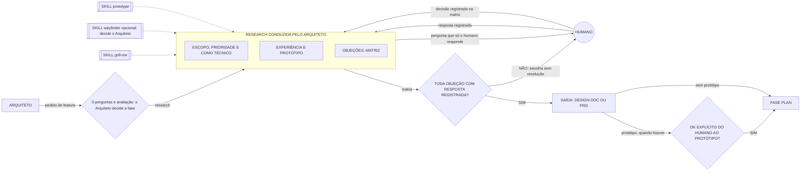

# Fábrica agêntica - Fase RESEARCH (fundo preto)

Registro em texto da fase RESEARCH na V2. O Arquiteto é o único bot da feature e conduz a research sozinho.

| Peça | Forma | O que faz |
| --- | --- | --- |
| Arquiteto | caixa | Recebe o pedido, responde SIM ou NÃO às 5 perguntas de classificação e, com as respostas e a avaliação, decide a fase. |
| 5 perguntas | losango | 1. Muda arquitetura? 2. Afeta mais de um serviço, ou um componente de que muitos dependem? 3. Tem ambiguidade de requisito? 4. É difícil de desfazer? Mexe em dados persistidos, faz migração ou quebra contrato de API? 5. Toca autenticação, permissões, dados pessoais ou segredos? Com as respostas e a avaliação, o Arquiteto decide a fase: research, plan ou implement. Não há roteamento fixo. |
| Research conduzida pelo Arquiteto | caixa | O Arquiteto decide escopo, prioridade e o como técnico, com a prioridade única de entregar valor ao usuário; decide a experiência com base nas práticas atuais de UX e UI e cria o protótipo quando há dúvida visual ou de interação; e levanta as objeções ao que está sendo decidido. |
| Skills grill-me, wayfinder (opcional), prototype | caixa tracejada de cantos retos | Perguntas duras; mapa de projeto muito grande (decide o Arquiteto; humano só se ele não conseguir); protótipo descartável. |
| Matriz de objeções | losango | Objeções claras e enumeradas, cada uma com o porquê, as causas, os riscos e os possíveis problemas futuros, e com resposta, evidências/limites, decisão ou estado e motivo. Nenhuma objeção sem resposta registrada segue para a síntese. |
| Humano | círculo | Responde as perguntas de requisito, decide a escolha que o Arquiteto não consegue resolver com a evidência disponível e valida o protótipo. |
| Design doc ou PRD | caixa | Saída: problema, opções, decisão e trade-offs. |
| Fase PLAN | caixa | Recebe o design doc ou PRD e o protótipo, quando houver. |

Toda fase nova (research, plan, implement e review) começa com o Arquiteto solicitando ao Cursor que abra uma nova sessão, com contexto limpo e com o modelo informado ou o padrão, sem exceção. O handoff entre fases passa sempre pelo Arquiteto, que dispara a sessão nova.

## Entrevista e protótipo bloqueiam o avanço

- Quando grill-me ou tlc-discover produzir pergunta para o humano, o modelo do Cursor DEVE PARAR antes de protótipo, síntese ou design doc. Não responde pelo humano, não converte pergunta em recomendação aceita e não fecha a research.
- O modelo devolve as perguntas ao Arquiteto e informa explicitamente que o research está BLOQUEADO AGUARDANDO ENTREVISTA DO HUMANO. O Arquiteto apresenta as perguntas ao humano e devolve as respostas ao Cursor.
- Só depois de receber as respostas do humano o modelo retoma o research. Ausência de resposta humana não é decisão.
- Ao receber o protótipo do research, o Arquiteto o apresenta ao humano e NÃO inicia o plan até um OK explícito dele. A análise do próprio Arquiteto não substitui a validação humana do protótipo.
- Critério de pronto da entrevista: perguntas e respostas humanas registradas; sem isso, o research está em espera, não concluído.

## Matriz de objeções e síntese

Esta regra vale somente para a fase de research. Não é uma nova rotina, webhook ou serviço.

O Arquiteto registra no documento/estado da demanda a matriz de TODAS as objeções: ID/descrição, resposta, evidências/limites, decisão ou estado pendente/resolvida e motivo. Nenhuma objeção sem resposta registrada pode avançar; critérios de aceite futuros não são resultados já verificados.

Escolha que o Arquiteto não consegue resolver com a evidência disponível vai ao humano, com as opções. A decisão humana é registrada na matriz e refletida nos insumos, sem baixar automaticamente as objeções restantes. A síntese segue a execução/skill prevista para a fase. Uma abertura por pedido/versão de insumos, sem duplicação ou laços.

Perguntas exigidas por grill-me/tlc-discover ou que só o humano pode responder interrompem a research conforme a seção de entrevista. Resposta humana real registrada é necessária para retomar; OK explícito do protótipo continua necessário antes de PLAN.

Quando a fase RESEARCH abrir grupo, ele se chama `research-<nome-da-feature>` (exemplo: `research-feat-nome-da-feature`), com o nome da feature igual ao da seção criada (prefixo `feat` ou `fix`, hífen e o nome em minúsculas com hífens). Regra em `../comunicacao.md`, seção 5.
