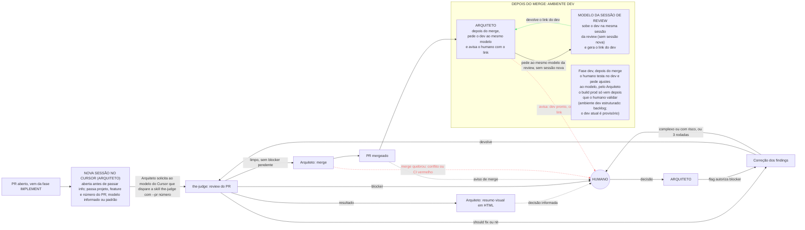

# Fábrica agêntica - Fase REVIEW

Registro em texto da fase REVIEW na V2. Entra depois do handoff da fase IMPLEMENT e termina com o PR mergeado. O Arquiteto é o único bot da feature e conduz a review inteira.

## Peças

| Peça | O que faz |
| --- | --- |
| the-judge | Review de PR. Classifica findings em blocker, should fix e nit. No máximo 3 rodadas por execução. Se estourar 3 rodadas com blocker, para e escala pro humano. Nova rodada, depois de uma correção, só revisa o diff novo. |
| Resumo visual | O Arquiteto transforma o resultado da the-judge em um HTML visual, com linguagem direta e simples, para facilitar a decisão. O HTML é visto no app do Grok Bot. Blockers e itens não bloqueantes (should fix e nit) ficam em destaque, e o que precisa de decisão humana é destacado. |
| Correção dos findings | Corrige should fix e nit, mexendo só no necessário, na sessão da review. Não reclassifica nem muda a severidade dos findings. Should fix complexo ou com risco de efeito colateral vai pro humano. Blocker nunca é corrigido sem flag de autorização humana. Depois de corrigir, devolve pra the-judge. No máximo 3 rodadas de correção; depois trava e escala. |
| Arquiteto (merge) | Dispara o merge no GitHub só se não houver blocker pendente e o veredito da última rodada da the-judge passou limpo. Nit pode permanecer. Se a correção usou flag de blocker autorizado e a the-judge validou, o merge é automático, sem nova avaliação humana. |
| Arquiteto | Faz a comunicação com o humano: leva as escaladas, registra as decisões e avisa o humano no merge. |
| Humano | Decide blocker, should fix complexo ou com risco e as travas anti-loop. Autoriza correção de blocker com flag. |
| PR mergeado | Handoff final da fábrica. |

## Review obrigatória antes do merge

Toda solicitação passa pela fase de review antes do merge, sem exceção de caminho. O Arquiteto não dispara merge nem trata autorização de PR como dispensa da review. A única exceção é quando o humano afirma por escrito que assume a responsabilidade e solicita bypass explícito do review.

## Travas anti-loop e escalada

- 3 rodadas da the-judge com blocker: para e escala pro humano.
- Correção dos findings: no máximo 3 rodadas; depois trava e escala.
- Should fix gerado 3 vezes seguidas após correções: trava para intervenção humana.
- Blocker novo: sempre vai pro humano.
- Should fix complexo ou com risco de efeito colateral: humano.
- Blocker com decisão humana que inclui sugestão de correção: corrige com a flag, a the-judge valida, e se passou o merge é automático, sem nova avaliação humana.

## Sessão da review

A review começa com o Arquiteto solicitando ao Cursor uma nova sessão, com contexto limpo e com o modelo informado ou o padrão, sem exceção, antes de passar qualquer informação. O handoff entre fases passa sempre pelo Arquiteto, que dispara a sessão nova. As rodadas da the-judge e da correção seguem na sessão da review.

## SUBIDA PARA PRODUÇÃO

1. O humano aprova o ambiente de dev.
2. Após essa aprovação, o Arquiteto pergunta ao humano se ele quer subir para o ambiente de produção e fazer o build de prod.
3. O Arquiteto só dispara o build de prod depois que o humano confirmar explicitamente. Ambiente de produção não pode ser gerado de forma automática sem confirmação humana.
4. **A subida vale para os DOIS ambientes, dev e prod.** Com a confirmação, o Arquiteto pede ao modelo do Cursor (mesma sessão da review), no mesmo pedido, a instalação da correção em dev E em prod, e acompanha até os dois confirmarem. Nunca pede nem faz só prod. Se um falhar ou ficar pendente, não diz que subiu: avisa qual falhou e pede a decisão.
5. **Pergunta de encerramento, logo depois.** No mesmo turno do aviso de que instalou nos dois ambientes, o Arquiteto pergunta ao humano se quer encerrar a feature, sem esperar o pedido, dizendo o alcance exato (Arquiteto, seção e grupos, sem volta). A pergunta não é autorização: só a resposta afirmativa explícita do humano gera o aviso ao Bootstrapper (`arquiteto-destruicao`, seção 24, com o ponteiro da mensagem dele). Sem resposta, resposta ambígua ou "depois", não há aviso e a feature segue aberta.

Quando a fase REVIEW abrir grupo, ele se chama `review-<nome-da-feature>` (exemplo: `review-feat-nome-da-feature`), com o nome da feature igual ao da seção criada (prefixo `feat` ou `fix`, hífen e o nome em minúsculas com hífens). Regra em `../comunicacao.md`, seção 5.
